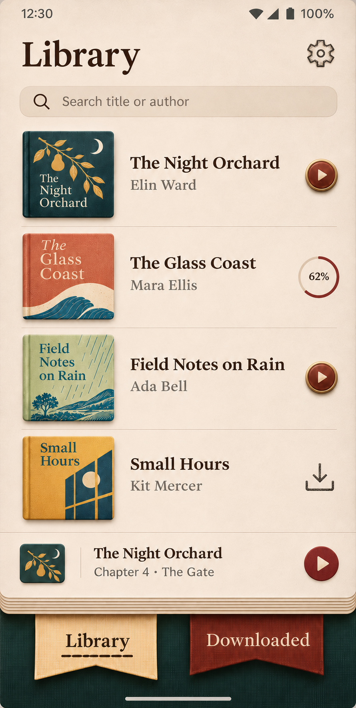
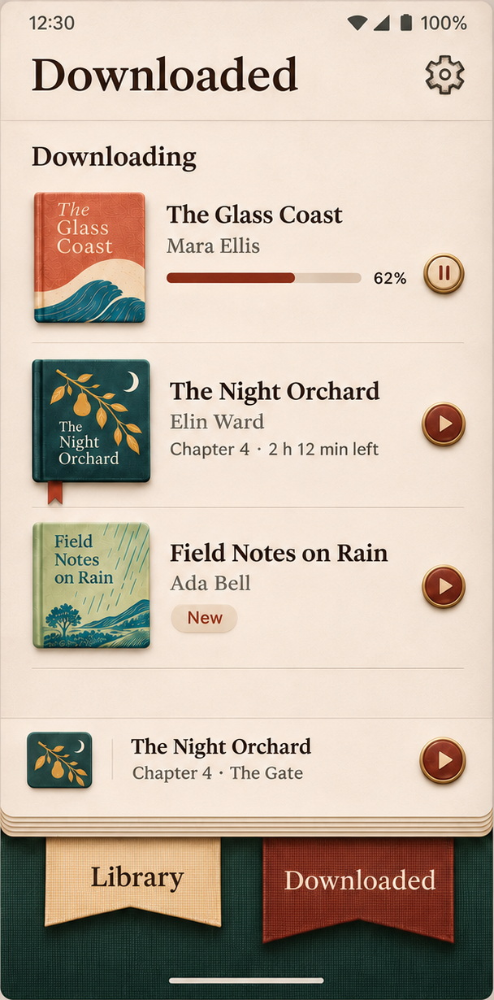
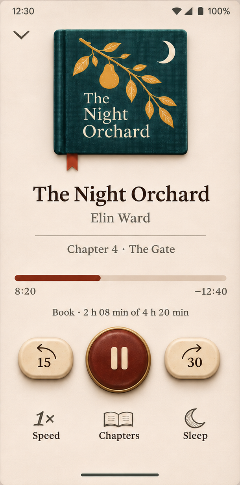
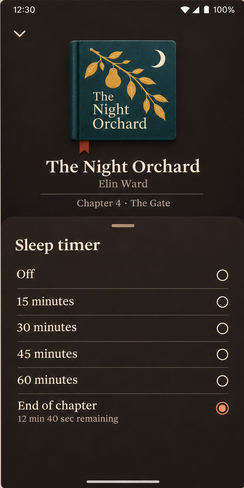

# Screen gallery

These four PNGs are the visual targets for the Android phone layout. They show example library data and independent moments in a listening session. Build text, insets, scrolling, navigation and controls with native components. Use the proportions and materials in the images along with the measurements and state rules in the [interface specification](02-interface.md).

| Library | Downloaded |
|---|---|
|  |  |
| [Open Library at full size](mockups/library.png) | [Open Downloaded at full size](mockups/downloaded.png) |

| Full player | Sleep sheet at night |
|---|---|
|  |  |
| [Open the full player](mockups/player.png) | [Open the night sleep sheet](mockups/sleep_night.png) |

## Reading the examples

- **Library.** The catalog opens directly on its section heading. The Night Orchard and Field Notes on Rain are ready to play. The Glass Coast is transferring. Small Hours has a download action. A tap on its cover opens details. A tap on its download glyph starts the transfer.
- **Downloaded.** The Glass Coast has its own transfer pause key. The Night Orchard is a completed download with a saved position. Field Notes on Rain is a completed download with no listening history. Both books work with the server disconnected.
- **Player.** The large key shows Pause because playback is running. Chapter 4 is 21 minutes long. At 8:20 elapsed there are 12:40 left in the chapter. The entire book is at 2 h 08 min of 4 h 20 min. The two time displays use different scopes. The app gives the second its own slimmer bar under the chapter’s, as the owner asked after the mockup was drawn.
- **Sleep.** The sheet lists Off, the listener's presets from Settings, and End of chapter. The illustration shows the older fixed list; its look still applies. Selecting a value applies it and dismisses the sheet. Reopening shows the current selection. “End of chapter” shares its target with the chapter timeline.

The separate screenshots have different raster sizes. Fit them to a common logical width when comparing. They set appearance, not size: the app draws type, covers and keys smaller, as the [interface](02-interface.md#type-color-and-layout) gives them. Apply the shared brass-rimmed face from the [asset guide](08-assets-and-implementation.md) to every playback button, including the mini-player. The player mockup draws the skip keys squarer than the delivered faces, and the faces set the proportion. Use the graphite masks and the system’s live time, battery, focus and gesture indicators throughout the implementation.
