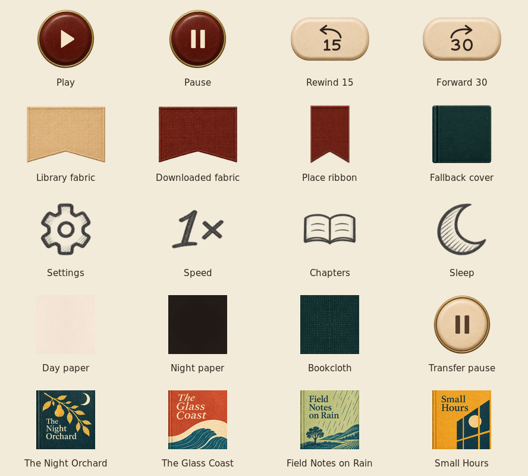

# UI assets and Android assembly

The [asset manifest](art/manifest.json) lists every individual resource, its exact pixel dimensions or vector viewport, its role and whether it has transparency. Files prefixed `pw_` have Android-compatible resource names. The [screen gallery](07-screen-gallery.md) shows the components in context. The overview below is a contact sheet made from the delivered files.

## Choosing an asset

| Directory | Contents | How to use it |
|---|---|---|
| [skins](art/skins/) | Blank red and ivory key faces, blank flax and red navigation tabs, narrow place ribbon, blank clothbound cover | Place live labels or inlays above the artwork. The PNG includes its edge treatment and transparent cutout. |
| [controls](art/controls/) | Ready-composed Play, Pause, Rewind 15, Forward 30 and Pause download | Quickest way to reproduce the art for a standard button. Change the displayed face from live state, add an accessible name, and apply pressed styling in Compose. |
| [graphite](art/graphite/) | Settings, Chapters, Sleep, Search, Collapse, Download, Check, Speed 1× and More | Each glyph sits on a transparent 128 × 128 canvas. Render with preserved aspect ratio and tint its alpha in the theme’s pencil color. |
| [inlays](art/inlays/) | Play, Pause, Back 15, Forward 30, each in PNG and Android VectorDrawable XML | Use a single vector over a blank face for custom sizes or contrast. Both formats describe the same inlay. |
| [materials](art/materials/) | Three 128 × 128 repeating samples for day paper, night paper and bottle-green cloth | Repeat the sample on its base color. These tiles are mirrored at the edges. Lower opacity until the texture recedes at phone scale. |
| [demo](art/demo/) | Four illustrated fictional book covers used by the mockups | Use in previews, screenshot tests and development fixtures. Download and cache the listener’s real book art for production. |

## Copying into Android

Put the chosen bitmap resources in `app/src/main/res/drawable-nodpi/` and assign an explicit size in dp when rendering. Put chosen XML inlays in `app/src/main/res/drawable/`. Use one representation for a given resource basename. In particular, copying both the PNG and XML versions of the same inlay into the same resource configuration causes a duplicate resource. Use the XML for layered Android buttons, or just use the pre-composed controls. Keep the cover examples in a debug/preview source set if the production application has no sample library.

Use a neutral `Image` or untinted `painterResource` for cloth, book art, key faces and complete keys. Material `Icon` tint is appropriate for the single-color pencil marks or an inlay. It would flatten a multicolor skin. Draw skin layers with `contentDescription = null` when the containing control supplies the accessible action. The manifest’s source sizes are raster dimensions, not touch target dimensions.

## Layer recipes

### Navigation bookmarks

1. Paint the green binding behind the footer, continuing behind the navigation inset where appropriate. Keep the interactive tabs above that inset.
2. Give each destination a stable, equally wide tab slot with selectable **Tab** semantics and a minimum 48 dp target. Place `pw_tab_flax.png` in Library and `pw_tab_oxblood.png` in Downloaded. Keep the woven colors attached to the destinations.
3. Size the fabric around 112–128 dp wide with its aspect ratio preserved. Conceal the top under the sheet. Draw the visible fishtail beyond the page edge. Vary the exposed length, about 44 dp for the inactive tab and 52 dp for the active tab. If space is tight, reduce the artwork width before reducing the tap target.
4. Position live, centered labels in the visible rectangular area above the V. Use dark ink on flax and pale ink on red. Apply selected weight and an optional short pencil underline for extra selection contrast. Translate artwork and label together. Never translate the selection region.
5. Draw 2–3 fine page edges and the sheet’s cast shadow over the upper ends of the cloth. When a book is loaded, place the mini-player on the sheet above the seam. It consumes layout height so list items cannot disappear behind it.

### Play, pause and skip

For a standard key, use `pw_play.png`, `pw_pause.png`, `pw_rewind_15.png` or `pw_forward_30.png` inside a native button with the default background removed. For a layered key, place `pw_inlay_play.xml` or `pw_inlay_pause.xml` over `pw_key_oxblood.png`. Apply the dark inlay tint for `pw_key_ivory_round.png`. Put the skip inlays over `pw_key_ivory_skip.png`. Size the central inlay to about 40–45% of the face width. Avoid double shadows around pre-shaded art.

| State | Drawing | Behavior and semantics |
|---|---|---|
| Paused / ready | Red face with ivory Play triangle | “Play [title]” or “Resume [title]” |
| Playing | Red face with ivory Pause bars | “Pause [title]” |
| Pressed | Lower face and inlay together 1–2 dp, tighten shadow | Fixed hit box and one media command per tap |
| Focused | High-contrast ring outside the face | Focus and current playback action remain independent |
| Temporarily unavailable | Subdued skin plus a reason where needed | Disable action and expose its disabled state |
| Active transfer | Ivory face with dark Pause bars | “Pause download of [title]” |

On a narrow screen, shrink the drawn face inside a 48 dp tap region. On a large-font screen, wrap or move metadata before shrinking labels. Set the button state from the playback service or transfer coordinator, including when an external control changed it.

### Utility icons, cover and paper

- Render each pencil mask in about a 24–28 dp visual area with an independent 48 dp target. Tint to the theme’s primary ink, using warm ivory at night. Keep the thin internal hatching and enough edge contrast on paper.
- Use `pw_pencil_speed_1x.png` only when the current speed is 1×. Other speeds are live values in a slightly slanted serif. Center the value in the same optical box. Support “Playback speed, 1.25 times” even when compact labels are abbreviated.
- Use `pw_cover_cloth.png` behind live title/author text for missing cover art. Center real cover art with aspect-preserving fit. A narrow `pw_place_ribbon.png` can peek 6–10 dp out of the bottom edge near the spine. Use a single ribbon even when the mockup artwork already shows one.
- Draw normal text, times, search fields, sliders, progress bars/rings, radio selections and dividers natively. Keep accessibility range actions and dynamic percentages. Use low-opacity material on unobstructed page areas. Keep texture away from fine glyph edges where it reduces contrast.

## Reviewing implementation

Open each PNG against the same background as its final destination. The blank keys and tabs should show transparent surroundings, including the V-shaped cutout between the tab’s tails. The mask tint should change the pencil strokes without filling their internal holes. Check interrupted transfers, paused and playing, night mode, a long translated label, 200% font scaling and a real device’s gesture inset. Run V01–V05 in the [delivery checks](06-delivery-and-tests.md).

The artwork is visual reference and reusable component art. The specified Android controls, focus targets, labels and media behavior still require implementation and device validation.
