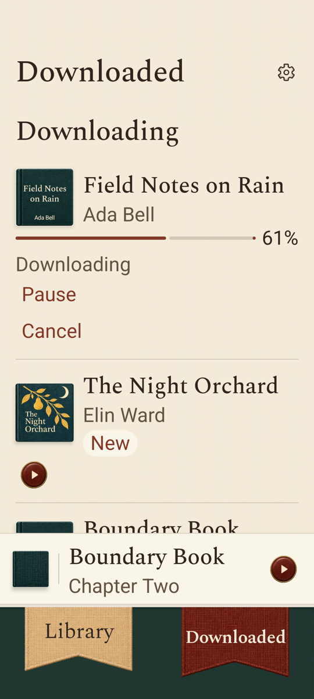
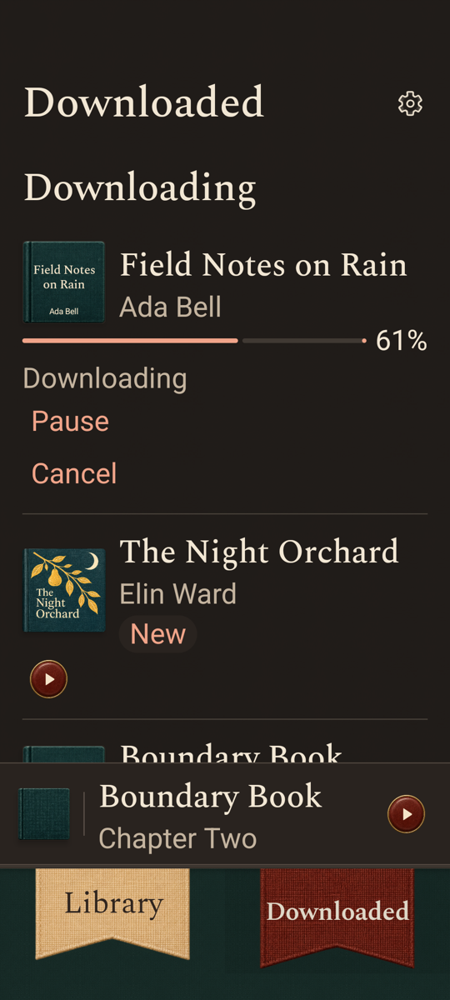
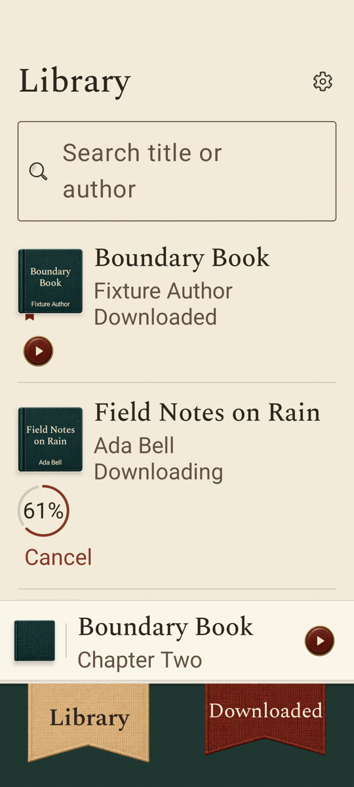
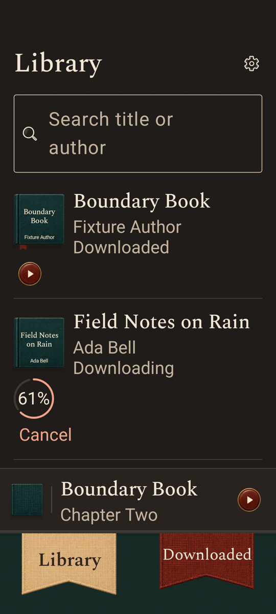
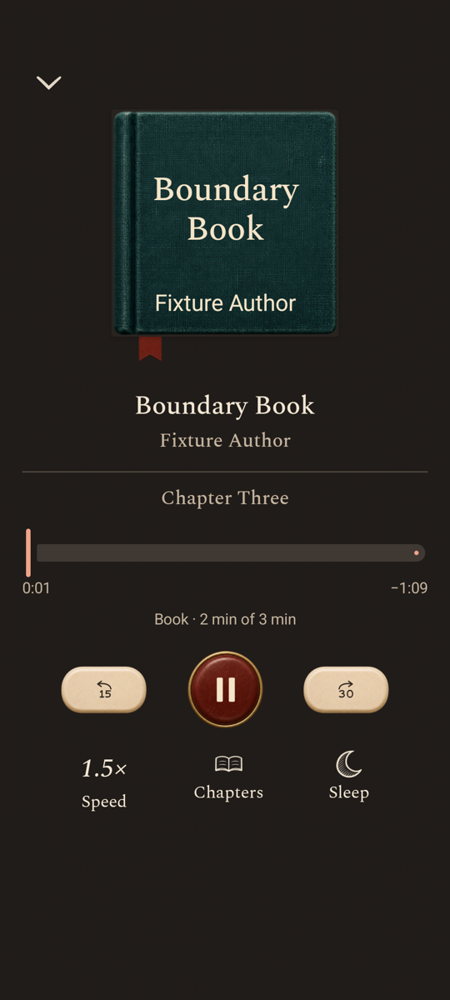

# M1 report: book identity, Room state and the two destinations

Date: 21 November 2026. Target: the [M1 exit check](../06-delivery-and-tests.md#milestones), and V01 to V05 of the [visual integration checks](../06-delivery-and-tests.md#visual-integration-checks), which run again with M5.

## 1. Delivered

- **Library and Downloaded** in the paper theme, with the flax and oxblood bookmarks, cloth covers with lettering and the place ribbon, rows for available, transferring and ready books, search, the mini player and the full player with its Speed, Chapters and Sleep sheets. Both destinations read Room: the profile's libraries and catalog, local editions, transfers and saved places.
- **Book identity and per-book places.** Every book is keyed by profile and item ID. The playback service saves each book's place on pause, seek, book switch and completion, and at least every 4 s of media while playing. Each book resumes at its own place after a restart, with the resume rewind after a rest of five minutes or more. A finished book stays finished until Replay.
- **Cold launch** opens Downloaded when the phone holds a downloaded book (A17).
- **Fixture data.** The debug build's `DemoActivity` seeds a demo profile with ready, transferring and available books from the reproducible fixtures, so every state can be shown without a server. The release build contains none of it.
- **200 % text** in light and dark themes: headings, rows and bookmarks stay visible, and every visible target is at least 48 × 48 dp.

## 2. Files and design decisions

- `ui/`: the Compose screens (`library/`, `downloaded/`, `player/`, `detail/`, `settings/`, `connect/`), shared components (`components/PaperScaffold.kt` for the paper sheet and the bookmark band, `Cover.kt`, `Keys.kt`, `Feedback.kt`), the theme from the design tokens (`theme/Theme.kt`) and the copy (`model/Copy.kt`). View models in `ui/state/` observe Room and the playback controller, as [the Android and data plan](../03-android-and-data.md#runtime-ownership) allows.
- `debug/DemoLibrary.kt`, `debug/DemoActivity.kt`: debug-only seeding from the fixtures.
- `playback/PlaybackController.kt`: a finished book is no longer checkpointed as unfinished when the listener switches to another book after its end; the service reads the progress writer at call time so tests can delay writes.
- **Material colours.** The Material colour scheme is built entirely from the tokens, with unfilled tracks as secondary ink washed into the paper, so no Material default shows on sliders, progress bars or fields.
- **Short visible labels.** Cancel, Pause, Resume and Remove show a short label and carry the full spoken name ("Cancel download of …").
- **Plan changes in this milestone** ([asset guide](../08-assets-and-implementation.md)):
  - The bookmark's exposed length is measured at the centre, from the paper seam to the apex of the fishtail notch (239 of the artwork's 300 px), so the label sits on whole fabric.
  - A bookmark label stays on one line and shrinks to fit, down to 10 sp, rather than breaking inside the word. At 200 % text "Downloaded" did not fit the 144 dp tab and broke as "Download / ed".

## 3. Builds, tests and targets

Machine and emulators as in the [M0 report](M0.md#3-builds-tests-and-targets): `pw-api34` (API 34, `UE1A.230829.050`) and `pw-api37` (API 37, `CE2A.260420.051.A3`), both Pixel 7 profiles with Google APIs arm64 images.

| Check | Command | Result |
|---|---|---|
| Debug build and JVM tests | `scripts/build.sh` | Passed at `7d3709f`: debug APK built, 80 JVM tests passed (35 of them M0 and M1; the rest start M2) |
| Instrumented suite, API 34 | `am instrument -w -e package ch.lkmc.pageworn ch.lkmc.pageworn.test/androidx.test.runner.AndroidJUnitRunner` | 23 passed, 8 skipped by design: the later halves of the restart cases and the M2 server phases skip themselves in a single run |
| Instrumented suite, API 37 | same | 23 passed, 8 skipped as above |
| Restart cases, API 34 and API 37 | each half of `RestartTest` in its own `am instrument` run, in name order | 7 of 7 passed on each target |
| CI | `.github/workflows/ci.yml` on the pushed commits | Failed on `4d30c4f`: `AddressHttpTest.changedCertificateOnSameOriginIsRejected` (an M2 test) rebound a port the runner had not released. Fixed in `23944b1`, where CI passed |
| V01 to V05 | `VisualChecksTest` on both targets | 5 of 5 passed; see below |

Restart cases need a new process between their halves. `am instrument` starts the app in a new process for each run and ends it without lifecycle callbacks when the run ends, which is the abrupt death the cases describe. A half run on its own in the same process as its first half skips itself.

M1 tests on both targets:

| Test | Acceptance |
|---|---|
| `DestinationStatesTest.seededDestinationsSearchAndPlayerShowLocalStates`: Downloaded is selected on a cold launch with downloads; the transfer group shows Field Notes on Rain at 61 % with Pause and Cancel; the ready books show New and the chapter badge, ordered by last listening; Library lists all five books in title order with their states and actions; search by author and a search without a match with Clear the search; the player opens at Chapter Two and collapses to Library | M1 states, A17, A18 order, A25 search |
| `LargeTextScreensTest.lightAndDarkDestinationsKeepLargeTextVisibleAndTargetsTouchable`: Library and Downloaded at 200 % text in light and dark themes | M1 large text, V05 part |
| `ProgressOrderTest`: a rest under 5 min resumes exactly; a rest of 5 min rewinds 10 s; the rewind stops at the start of the book; a seek while paused makes the next start exact; another book for 10 min rewinds the resting one | A29 |
| `ProgressOrderTest.a18DownloadedOrderAndReplay`: a finished, a partly listened and a never-played book sort by last listening, then by download time; Replay starts at zero; the partly listened book resumes at its place | A18 |
| `RestartTest.a10…`: pause A late, listen to B, deliver A's delayed position callback, restart: both places hold and each book resumes at its own place | M1 exit check, A10 |
| `RestartTest.a10b…`: at 2×, a held sample from 115 s is delivered after a seek back to 75 s and a pause: 75 s survives the restart; then the process dies just before a checkpoint and loses at most 5 s of book time plus the 100 ms seek tolerance | A10b |
| `RestartTest.a29…`: pause at 115 s, the process dies, ten minutes later a media-button Play resumes at 105 s | A29 (the Bluetooth headset is an owner check) |

Large-text screens from the API 37 run:

| | Light | Dark |
|---|---|---|
| Downloaded |  |  |
| Library |  |  |

Since 23 November 2026 the app has no night theme and keeps the day paper when the phone is dark, at the owner's request. The Dark screenshots here and the V04 screenshot below record the earlier night theme. The large-text test is now `LargeTextScreensTest.lightAndDarkPhoneKeepDayPaperLargeTextVisibleAndTargetsTouchable`. See the [day theme report](day-theme-2026-11-23.md).

**V01 to V05** (`VisualChecksTest`, 5 of 5 on both targets, plus the two screen tests above). The parts that need eyes or a person stay open for M5.

| ID | Checked on the emulators | Not yet checked |
|---|---|---|
| V01 | Library, Downloaded, the player and the sleep sheet each have exactly one heading, the section or book title; no node shows "Pageworn" | The absence of vacant rows judged by eye |
| V02 | Both bookmarks report the tab role and their selection; switching by touch, and by a hardware keyboard (Tab until the Library bookmark has focus, then Enter), selects the chosen tab | TalkBack traversal and announcements; the fabric colours and the extended active tail are confirmed on the screenshots, not by the test |
| V03 | The mini and full player keys describe Resume while paused and Pause while playing; a system media pause (`cmd media_session dispatch pause`) returns both to Resume; the download's Pause is a separate control | Pausing from the notification shade by touch |
| V04 | Choosing 1.5× is announced in the Speed utility's description, a reopened sheet has exactly one selected radio, choosing a chapter moves the player to it, the sleep sheet has exactly one selected radio, and in night theme the utilities stay visible (screenshot below) | Spoken announcement of a chosen sleep timer's remaining time, with TalkBack (M5) |
| V05 | At 200 % text with high-contrast text, all animations off and landscape: both bookmarks show and switch, the Library heading shows, every fully visible target is at least 48 × 48 dp, and the mini key plays and pauses | Rotation while a sheet is open; TalkBack at 200 % (M5) |

Found and fixed during these checks: the mini player key said Play for a book with a saved place while the row and the full player said Resume; it now says Resume (V03).

## 4. Failing or unrun acceptance cases

No M1 exit check failed. Cases with M1 parts that finish later:

| ID | Covered in M1 | Remaining, and where |
|---|---|---|
| A17 | Cold launch opens Downloaded when the phone holds a download | Launch with no profile and the status priorities (M2, M3) |
| A18 | Order and Replay through the service and the Downloaded view model | Replay from the row through the UI with a real download (M3) |
| A25 | Search by title and author over the demo catalog, no-match message | Several libraries, mixed media, excluded files and relaunch against the server (M2, M3) |
| A29 | All decisions through the service, process death and a media-button start | Bluetooth headset start (owner check) |

The remaining acceptance cases belong to later milestones and have not run.

## 5. First unfinished milestone

M2: sign-in, pairing, failover, certificate trust, sign-out and the catalog.

## 6. Completing commit and pending owner checks

M1 is complete at commit `7d3709f` on `main`; this report is committed on top of it. The commits between `97755df` and `7d3709f` also begin M2 (the server contracts, credential storage, routing, the network client, the catalog refresh and the account service). Each builds and passes its tests, and M2 reports on them when it is complete.

Owner checks that M1 leaves pending, with steps:

- **Phone, large text and themes.** Set Display size and Font size to the largest values, open Library and Downloaded with the phone in light and in dark mode, and confirm that both show the day paper, every label is readable and every button can be pressed. Repeat with the gesture navigation and with 3-button navigation.
- **Phone, a headset start after a rest.** Play a downloaded book for a minute, pause it from the headset, wait ten minutes with the phone locked, then press Play on the headset. Playback should start 10 seconds before the pause. This needs the M4 build for real downloads.
- The other [owner checks](../06-delivery-and-tests.md#owner-checks) stay pending as listed in the [M0 report](M0.md#6-completing-commit-and-pending-owner-checks).
